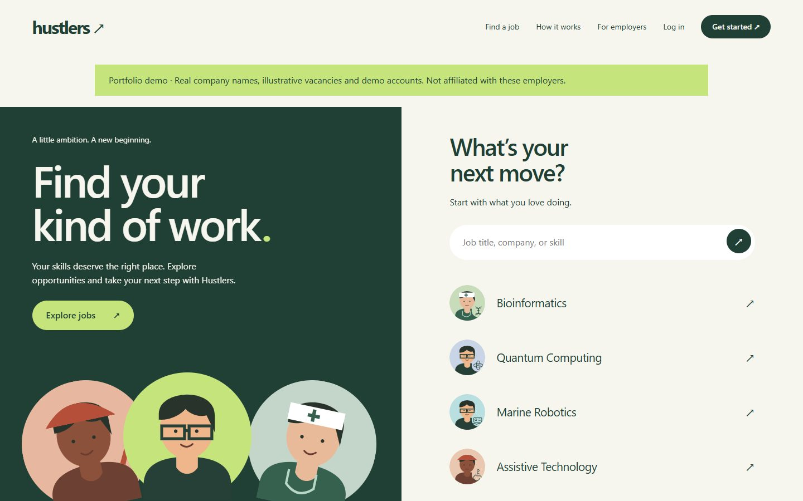

# Hustlers Platform

A PHP and MySQL job portal for job seekers and employers, with skill-based candidate matching, multiple résumé versions and hiring offers.



## Features

- Employer and seeker registration, hashed-password login and role-based access.
- Job search by field, location and work type, with annual INR salaries.
- Candidate profiles with skills, education, experience, work history and optional age.
- Employer candidate discovery with transparent required-skill matching.
- Multiple private PDF résumés; candidates select a version for each application.
- Application tracking, saved jobs and employer hiring offers that candidates can accept or decline.
- Responsive layouts, 20 occupational avatars, smooth scrolling and reduced-motion support.

## Requirements

- PHP 8.2+ with PDO_MYSQL, fileinfo, mbstring and sessions.
- MySQL 8+ or MariaDB 10.4+; development was tested with XAMPP MariaDB 10.4.
- A writable persistent directory for résumé uploads.
- Git to clone the repository. There is no Node.js build, Composer install or frontend dependency installation.

GitHub stores the source. GitHub Pages cannot execute this PHP application or host its database; use PHP hosting for the live website.

## 1. Download the project

```powershell
git clone https://github.com/Jaswanth-Raj27/Hustlers-Platform.git
cd Hustlers-Platform
```

Install XAMPP if PHP/MySQL are not already available. Start **MySQL** in the XAMPP Control Panel. If using phpMyAdmin, start **Apache** too. Keep MySQL running while using the website.

## 2. Create the database and import the schema

### Option A: phpMyAdmin

1. Open `http://localhost/phpmyadmin`.
2. Create a database named `job_portal`, using `utf8mb4_unicode_ci` collation.
3. Select the new database, open **Import**, choose the repository's `schema.sql`, and click **Import**.
4. Confirm that `euser`, `juser`, `eprofile`, `jprofile` and the supporting tables appear.

### Option B: MySQL command line on Windows

```powershell
& C:\xampp\mysql\bin\mysql.exe -u root -p
```

Enter your local administrator password when prompted. A standard local XAMPP installation may have an empty root password; press Enter only if that is how your installation is configured.

In the MySQL prompt:

```sql
CREATE DATABASE job_portal CHARACTER SET utf8mb4 COLLATE utf8mb4_unicode_ci;
USE job_portal;
SOURCE C:/absolute/path/to/Hustlers-Platform/schema.sql;
EXIT;
```

Replace the SOURCE path with your actual clone path, using forward slashes. `schema.sql` is for a **new, empty database**. It creates tables without importing anyone's private records. Back up an existing database before changing it. Do not import the old profile/resume ALTER scripts after importing this complete schema.

## 3. Connect PHP to the database

```powershell
Copy-Item .\config\database.example.php .\private\database.php
```

Edit `private/database.php` to match your local MySQL configuration:

```php
<?php
return [
    'host' => '127.0.0.1',
    'port' => '3306',
    'name' => 'job_portal',
    'user' => 'root',       // Local setup only
    'password' => '',      // Your actual local MySQL password
];
```

`database.php` reads this protected configuration and creates a PDO MySQL connection. `bootstrap.php` starts the authenticated session and makes the connection available to the pages. `private/database.php` is ignored by Git: **never commit your real connection credentials**.

For hosting, server environment variables can override the configuration: `HUSTLERS_DB_HOST`, `HUSTLERS_DB_PORT`, `HUSTLERS_DB_NAME`, `HUSTLERS_DB_USER`, `HUSTLERS_DB_PASSWORD`. A `.env` file is not automatically loaded. Keep actual secrets in your host's environment/settings or protected local configuration.

## 4. Add the optional portfolio demo data

With a database owner/administrator configured locally:

```powershell
& C:\xampp\php\php.exe .\seed-demo.php --reset-demo
```

**This command deletes existing application records in the configured database before seeding. Run it only on a fresh/demo database, never on real production data.** It creates:

- 11 company demo accounts and 52 example vacancies.
- 24 job seekers with linked profiles, skills, education and experience.
- 20 fields of work, example applications and saved jobs.

No real résumé files are generated. Existing seeded applications therefore have no document attachment; new applications require a résumé uploaded by their owner. Repeated demo resets can leave old private files on disk: use a fresh demo upload directory when rebuilding a disposable demo.

### Demo logins

All demo accounts use password **`HustlersDemo!2026`**.

| Login email | Company example |
|---|---|
| employer1@hustlers.example | Zoho |
| employer2@hustlers.example | Apollo Hospitals |
| employer3@hustlers.example | Larsen & Toubro |
| employer4@hustlers.example | TCS |
| employer5@hustlers.example | Infosys |
| employer6@hustlers.example | Tata Steel |
| employer7@hustlers.example | Dr. Reddy's Laboratories |
| employer8@hustlers.example | Wipro |
| employer9@hustlers.example | HCLTech |
| employer10@hustlers.example | Siemens |
| employer11@hustlers.example | Bosch |

Seeker logins are `seeker1@hustlers.example` through `seeker24@hustlers.example`, with the same password. Either login page recognises both account types. The passwords stored in SQL tables are **hashes**; do not paste those values into the login form.

Company names/public overviews are real, but these accounts are unaffiliated portfolio examples. Vacancies, salaries, applications and candidate backgrounds are illustrative and must not be presented as verified recruitment activity. Public company source URLs are included in the company descriptions. Do not reuse demo credentials for real accounts.

## 5. Run the website

From the clone directory:

```powershell
& C:\xampp\php\php.exe -S 127.0.0.1:8085 router.php
```

Open **http://127.0.0.1:8085/**. If PHP is on PATH, `php -S 127.0.0.1:8085 router.php` also works. Keep the terminal open; Ctrl+C stops the server. Use `router.php`: it blocks direct access to private data and internal source files. This built-in server is for local development only.

For Apache/XAMPP hosting, place the project under `htdocs`, start Apache and MySQL, and open `http://localhost/Hustlers-Platform/`. Apache must honor the included `.htaccess` files and support the `Require` directives. Do not expose a local XAMPP installation directly to the Internet.

## Database relationships

| Main table | Purpose | Foreign key |
|---|---|---|
| `euser` | Employer authentication and company details | `id` is the employer account ID |
| `juser` | Job seeker authentication | `id` is the seeker account ID |
| `eprofile` | Job vacancies displayed on the website | `employer_id → euser.id` |
| `jprofile` | Candidate details displayed to employers | `user_id → juser.id` |

There are no additional generic account/profile tables. Supporting tables are `applications`, `saved`, `hiring_invitations`, `resumes`, `categories`, `attempts` and `migrations`. Applications connect a seeker to a job and its chosen résumé. The résumé foreign key also verifies that the résumé belongs to that application's seeker.

The session stores the role and account ID. Employer-owned actions and candidate visibility are checked on the server; passwords never appear in profile pages.

## Résumés and file storage

1. Sign in as a seeker and open **My workspace → Edit linked profile**.
2. Fill your professional details and choose whether employers can discover you.
3. Under **Your résumés**, upload one or more PDFs.
4. Open a job and select the résumé version you want to send.
5. The job's employer can download only the selected version from the application.

PDF only, up to 5 MB each, five files per upload, ten active résumés per seeker. Archiving prevents future selection but retains documents attached to existing applications. Downloads require authentication. Validation checks size, extension, MIME type and PDF header; this is not a malware-scanning service.

Default storage is `private/resumes`. For deployment set `HUSTLERS_UPLOAD_DIR` to an absolute **persistent directory outside the web root**, writable by PHP. Back up that directory together with the database. Set PHP `upload_max_filesize` to at least `5M`, `post_max_size` to at least `26M`, and `max_file_uploads` to at least `5`. Restart PHP/Apache after changing php.ini.

## Skill matching and hiring

Employers enter comma-separated required skills when posting a job. Candidates enter their own skills in the profile. Select an owned role on the candidate directory to rank visible candidates by the share of required skills they list. The UI shows matches and missing requirements. It recognises explicit aliases and ignores case; it does not equate Java with JavaScript or use age in ranking. This compares skill lists, not proficiency or suitability.

Employers can offer one of their own roles to an accessible candidate. Candidates accept or decline in their workspace. Offers are in-app records; email delivery, contracts and payroll are not implemented.

## Production database account

After installing/seeding with an administrator, use a separate web account with a unique strong password. Example SQL, run as your database administrator:

```sql
CREATE USER 'hustlers_app'@'127.0.0.1' IDENTIFIED BY 'REPLACE_WITH_A_STRONG_PASSWORD';
GRANT SELECT, INSERT, UPDATE, DELETE ON job_portal.euser TO 'hustlers_app'@'127.0.0.1';
GRANT SELECT, INSERT, UPDATE, DELETE ON job_portal.juser TO 'hustlers_app'@'127.0.0.1';
GRANT SELECT, INSERT, UPDATE, DELETE ON job_portal.eprofile TO 'hustlers_app'@'127.0.0.1';
GRANT SELECT, INSERT, UPDATE, DELETE ON job_portal.jprofile TO 'hustlers_app'@'127.0.0.1';
GRANT SELECT, INSERT, UPDATE, DELETE ON job_portal.applications TO 'hustlers_app'@'127.0.0.1';
GRANT SELECT, INSERT, UPDATE, DELETE ON job_portal.saved TO 'hustlers_app'@'127.0.0.1';
GRANT SELECT, INSERT, UPDATE, DELETE ON job_portal.hiring_invitations TO 'hustlers_app'@'127.0.0.1';
GRANT SELECT, INSERT, UPDATE, DELETE ON job_portal.resumes TO 'hustlers_app'@'127.0.0.1';
GRANT SELECT, INSERT, UPDATE, DELETE ON job_portal.attempts TO 'hustlers_app'@'127.0.0.1';
GRANT SELECT ON job_portal.categories TO 'hustlers_app'@'127.0.0.1';
```

Then set the website's database username/password to that account. On shared hosting, use the provider's database/user tools and its required host/account names instead. Do not grant schema-administrator privileges to the public web application. The demo reset modifies categories and should use an administrator, not this restricted web account.

## Deploying

Choose PHP hosting with MySQL/MariaDB, HTTPS and persistent upload storage. Upload the application, import the fresh schema or securely transfer your own database, configure credentials and storage, and enable PHP error logging with `display_errors` disabled. Do not copy local credentials, test dumps or uploaded résumés into Git.

Apache must honor `.htaccess`. Nginx ignores `.htaccess`, so configure equivalent rules to deny dotfiles, `private/`, `config/`, SQL/Markdown files, CLI seed/data files and internal includes. Execute only the public PHP routes listed in `router.php`. Confirm `/private/database.php`, `/.git/config`, `/schema.sql` and internal includes return 403/404. Never serve the repository's `.git` directory.

Before real public use, add password recovery, email verification, actual support/privacy/terms, employer verification/moderation and appropriate upload screening. These are not implemented. No email notifications are sent. A portfolio demonstration should use fictional visitor data.

## Troubleshooting

| Problem | What to check |
|---|---|
| Database connection refused | Start MySQL; confirm host and port in `private/database.php`. |
| Access denied | Check the database username/password and grants for the configured host. |
| Unknown database or missing table | Create/select the correct database and import `schema.sql`. |
| PHP source displayed/downloaded | Use a PHP server, not a static file server or GitHub Pages. |
| Incorrect login | Use the original password, not the SQL hash; demo password is `HustlersDemo!2026`. |
| Too many login attempts | Wait 15 minutes before retrying; do not repeatedly paste database hashes. |
| No jobs/candidates | Seed a disposable demo database or register/post data; candidates must opt into discovery or apply to your role. |
| Application requires résumé | Upload a PDF from your profile and select it in the application form. |
| PDF upload fails | Check the 5 MB limit, PHP upload settings, valid PDF format and storage write permissions. |
| Existing résumé download missing | Restore persistent files along with the database; SQL alone does not contain uploaded PDFs. |

## Project layout

`app.php` handles page routing and core form actions; `bootstrap.php` manages sessions/database helpers; `database.php` loads connection settings. Profile, candidate, company, offer and résumé includes separate those screens. `skills.php` handles deterministic matching. `assets/` contains local CSS/JavaScript/SVGs. `schema.sql` defines the database, and `seed-demo.php` with `demo-*.php` and `avatar-updates.sql` recreates optional demo data.

Validation performed during development includes PHP syntax checks, isolated fresh-schema seeding, registration/login, profile privacy, job/application workflows, skill matching, offer ownership, multiple PDF uploads and résumé download authorization. Uploaded content, private configuration and database backups are excluded from this repository.

Run the included skill-matching checks without a database:

```powershell
& C:\xampp\php\php.exe .\tests\skills.php
```
